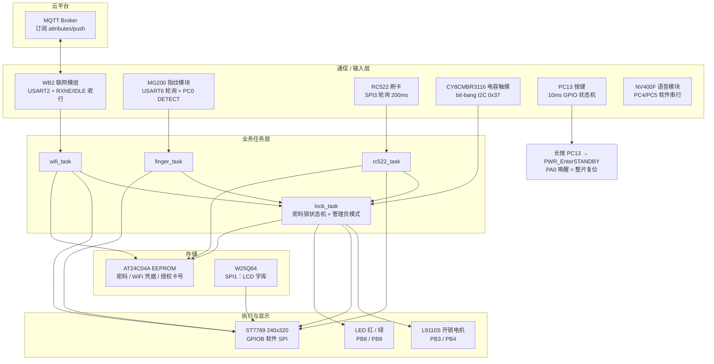
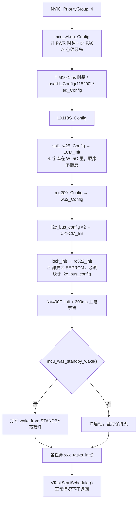
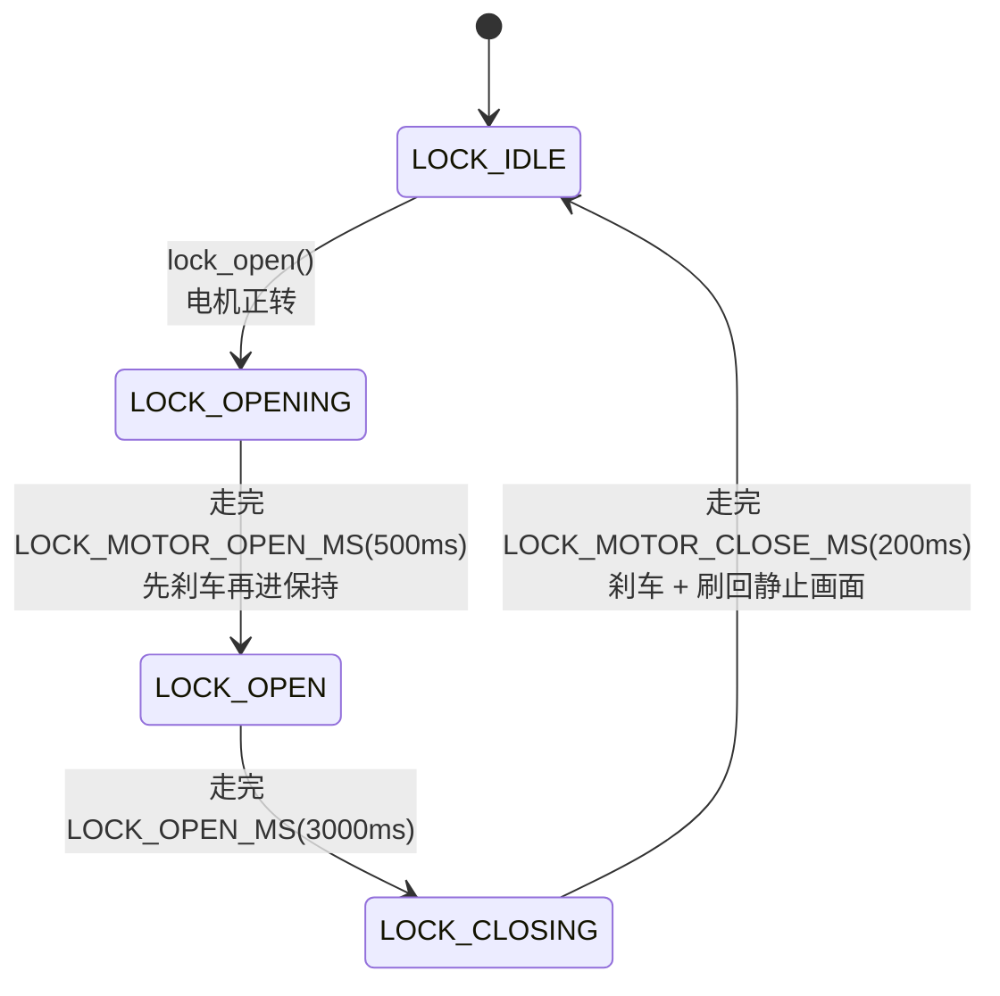

# STM32F401 智能门锁

基于 **STM32F401xx** 的智能门锁固件：电容触摸板密码 / MG200 指纹 / RC522 刷卡三条本地开锁来源 + WB2 联网模块的云端密码开锁，配 LCD 交互界面、管理员模式（改密码 / 加删指纹 / 加卡 / 清库 / 蓝牙配网）与 PA0 待机唤醒。

> 本文档由系统架构、环境搭建、软件架构、命名规范与代码分级、Bug 排查逻辑记录、已知问题与未来规划六个部分构成，建议结合提交历史（`git log`）与 [CLAUDE.md](CLAUDE.md) 阅读。
>
> ⚠ 本工程是 **标准外设库（StdPeriph）不是 HAL**，构建链是 **eIDE 不是 `project.uvprojx`**。见 §2.2。

## 1. 系统架构

### 1.1 总体框图



**三条开锁来源收敛到同一个出口**：密码、指纹、刷卡互不知道对方存在，各自比对通过后都只做一件事 —— 调 `lock_open()`。这个函数在临界区里做 check-and-set 抢 `s_unlocking` 标志，抢到才驱动电机。所以"同一时刻只有一个人在开锁"这条不变量只有一份实现，谁也不用担心另外两条路。

### 1.2 启动流程（`user/main.c`）



初始化顺序是**硬依赖链**，不是随手排的：

| 约束 | 原因 |
|---|---|
| `mcu_wkup_Config()` 必须最先 | 访问任何 PWR 寄存器前必须先开 APB1 上的 PWR 时钟 |
| `spi1_w25_Config()` 早于 `LCD_Init()` | 屏的字库存在 W25Q 里，屏一初始化就要去读 |
| `i2c_bus_config()` 早于 `lock_init()` / `rc522_init()` | 两者都要读 EEPROM 里的密码 / 卡号 |
| 所有 `xxx_init()` 早于 `vTaskStartScheduler()` | 它们里面有 EEPROM 写和复位脉冲，走的是 `Delay_Ms()` **NOP 忙等**；调度器起来之后会把别的任务饿死 |

`printf` 的物理出口是 `main.c` 的 `fputc()` → 直接轮询 `USART1->SR` 的 TXE 位 → USART1（PA9/PA10，115200）。**这是全工程唯一的调试通道**，它坏了所有排查手段跟着哑。

### 1.3 核心状态机

| 状态机 | 位置 | 说明 |
|---|---|---|
| 密码锁状态机 | [api/lock.c](api/lock.c) | `IDLE → OPENING → OPEN → CLOSING → IDLE`，由 `lock_tick()` 每 20ms 推进 |
| 管理员模式 | [api/admin.c](api/admin.c) | 开锁后 15 秒窗口，`111#`~`555#` 进子模式；**不建任务**，跑在 `lock_task` 里 |
| 按键状态机 | [api/key.c](api/key.c) | `IDLE → DEBOUNCE → PRESSED → RELEASE`，3 拍消抖（`key_scan_task` 每 10ms 调一次 = 30ms） |
| MG200 指纹帧 | [api/MG200.c](api/MG200.c) | 帧头同步 `0x6C` + 每字节超时，见 §5.1 |
| WB2 AT / MQTT | [api/wifi.c](api/wifi.c) | 连 WiFi → 连 MQTT → 订阅 → 常驻收发 + 10 秒心跳 |

#### 1.3.1 密码锁状态机

原来"开锁 → 保持 3 秒 → 回锁"是一整块写死在 `lock_open()` 里的**阻塞流程**。坏处是这 4 秒里 `lock_task` 完全没法响应任何东西 —— 按键收不动、云端命令在队列里干等，连挂在它上面的管理员模式窗口都被吃掉一大半。拆成状态机之后每一拍都能回去收队列。



- **开锁和回锁的行程时间是两个独立的宏**（`LOCK_MOTOR_OPEN_MS` / `LOCK_MOTOR_CLOSE_MS`）。推锁舌出去和收锁舌回来是两个不同的物理过程，合成一个值必然一边偏早（锁没真打开）、一边偏晚（顶到头还在转，堵转发热）。
- **电机只在 `OPENING` + `CLOSING` 这 700ms 里通电**，保持期内是断电刹车的。所以"能不能画屏"要用 `lock_motor_running()` 判断，而不是 `lock_is_busy()` —— 后者覆盖整整 3.7 秒，拿它当门闩会让菜单晚 3 秒才出现。
- 远程**关锁**命令曾经存在（`{"DoorLock":0}`），后来整个删掉了：关锁同样会推电机，而它当时**不需要任何凭据**。现在开锁之后老实等 3 秒自动回锁。

#### 1.3.2 管理员模式

电容板用密码开锁成功后进 **15 秒窗口**，期间输入子模式代码：

| 代码 | 子模式 | 谁干活 |
|---|---|---|
| `111#` | 初始化：清空指纹库 + 删授权卡 | `finger_task` + `rc522_task`（同时派活） |
| `222#` | 改密码（连输两遍） | **admin 自己做**（纯键盘输入，只碰 EEPROM） |
| `333#` | 加 RFID 卡 | `rc522_task` |
| `444#` | 加指纹 | `finger_task` |
| `555#` | 蓝牙配网（20 秒） | `wifi_task` |

三条设计约束，缺一不可：

1. **没有自己的任务。** 整台状态机跑在 `lock_task` 里（`admin_tick()` / `admin_handle_key()` 两个钩子点）。因为它必须在"锁还在开锁 / 保持 / 回锁"的同时保持响应 —— 一旦阻塞等手指，`lock_tick()` 就停摆、锁不回锁。
2. **长活派给外设所有者。** admin 只 `xxx_request_yyy()` 投一个标志，真正的动作由本来就拥有那个外设的任务干（MG200 归 `finger_task`、RC522 归 `rc522_task`、USART2 归 `wifi_task`）。
3. **画屏也必须是不阻塞的。** 这条最反直觉 —— 见 §5.2。

窗口是**"按键重置"的倒计时**，不是固定窗口：`111#` 要按 4 下，固定窗口会让手慢的人按到一半被踢出去。子模式内另有 `ADMIN_SUB_TIMEOUT_MS`（20s）兜"按一半走人"。

#### 1.3.3 云端开锁

订阅 `attributes/push`，载荷格式：

```json
{"Password":"123456"}
```

解析在 [api/wifi.c](api/wifi.c) 的 `wifi_handle_downlink()`，比对走 `lock_check_password()` —— **和键盘输入同一份实现**，所以管理员用 `222#` 改的密码就是云端要用的密码，不存在"两套密码"。

严格的格式要求（任何一条不满足就整条丢弃，绝不瞎猜）：

- 字段必须带引号找 `"Password"`（免得误命中 `"PasswordExpire"`）
- 值必须**是带引号的字符串**，不认裸数字（`{"Password":123456}` 的前导零保不住）
- 必须**恰好 6 位纯数字**，且第 7 个字符必须是引号 —— 少了这一句，`{"Password":"12345678"}` 会被当成 `123456` 收下

⚠ **上报路径的日志全部脱敏**（`wifi_print_masked()`）：载荷里装的就是开锁密码，而 USART1 那头接的是电脑、日志会被截图外发。

### 1.4 FreeRTOS 任务与队列

| 任务 | 栈（**字**，不是字节） | 优先级 | 位置 | 职责 |
|---|---|---|---|---|
| `wifi` | 512 | 1（最低） | [api/wifi.c](api/wifi.c) | WB2 AT 状态机 → WiFi → MQTT 收发 + 心跳 |
| `lock` | 384 | 2 | [api/lock.c](api/lock.c) | 密码输入 + 管理员模式 + `lock_tick()` 推电机 |
| `finger` | 256 | 2 | [api/finger.c](api/finger.c) | 轮询 PC0 → MG200 比对 / 录入 / 清库 |
| `key_scan` | 256 | 2 | [api/key.c](api/key.c) | PC13 每 10ms 采样，跑消抖状态机 |
| `cy9cm_scan` | 256 | 2 | [api/CY9CM.c](api/CY9CM.c) | 扫描电容触摸板按键，投递到队列 |
| `rc522` | 256 | 2 | [api/rc522_task.c](api/rc522_task.c) | 每 200ms 寻卡 |
| `key_action` | 128 | 3 | [api/key.c](api/key.c) | 消费按键事件，长按 → 进 STANDBY |
| IDLE | 128 | 0 | 内核 | `vApplicationIdleHook()` |
| Tmr Svc | 128 | 2 | 内核 | 软件定时器服务 |

| 队列 / 互斥量 | 深度 | 位置 | 生产者 → 消费者 |
|---|---|---|---|
| `cy9cm_key_queue` | 8 | api/CY9CM.c | `cy9cm_scan` → `lock` |
| `key_queue` | 8 | api/key.c | `key_scan` → `key_action` |
| `lock_cmd_queue` | 4 | api/lock.c | `wifi_task` → `lock` |
| `s_lcd_mtx`（递归） | — | api/lcd.c | 见 §5.3 |

`configMAX_PRIORITIES = 5`，实际优先级 0~4。**优先级只有 1 / 2 / 3 三档**：`wifi` 最低（它慢、它可以等），交互类全在 2，`key_action` 抢到 3 图个响应快。

### 1.5 中断资源与优先级

分组：`NVIC_PriorityGroup_4` → **4 位全给抢占优先级（0~15），没有子优先级**。`configMAX_SYSCALL_INTERRUPT_PRIORITY = 0xB0`（= 优先级 11），**优先级数值 ≥ 11 的中断里才能调 `...FromISR` API**。

| 抢占 | IRQ | 位置 | 用途 |
|---|---|---|---|
| 1 | `TIM1_UP_TIM10_IRQn` | [tim.c](api/tim.c) | 1ms 时基 `tim10_tick_ms`（不依赖调度器，裸机阶段也在用） |
| 1 | `DMA2_Stream5_IRQn` | [dma.c](api/dma.c) | 串口字库下载双缓冲 |
| 3 | `USART2_IRQn` | [wifi.c](api/wifi.c) | WB2 收行（RXNE + IDLE 判一帧结束） |
| 3 | `USART1_IRQn` | [usart1.c](api/usart1.c) | 收上位机命令到 `str_buf`（printf 同一条线） |
| n/a | `USART6_IRQHandler` | [MG200.c](api/MG200.c) | **存在但未使能 NVIC** —— 指纹走轮询接收 |

⚠ `usart1.c` 里的 `USART1_IRQHandler` 和 `usart1_rev_byte()` **不能混用**：ISR 会先把 RXNE 里的字节取走，轮询就永远等不到。USART6 同理（指纹模块）。

### 1.6 内存分配

| 区域 | 大小 | 说明 |
|---|---|---|
| Flash | 512KB (`0x08000000`) | 当前占用 **39.0KB (7.6%)** |
| SRAM | 96KB (`0x20000000`) | 当前占用 **22.2KB (23.2%)** |
| 启动文件栈 `Stack_Size` | **1KB** (`0x400`) | MSP，**只在调度器起来之前用**（`main()` 裸机阶段，含 `LCD_Init`、`mg200_add_finger()` 的局部变量）。调度器起来后每个任务用自己的栈，MSP 只在中断里用 |
| 启动文件堆 `Heap_Size` | **512B** (`0x200`) | C 库的 `malloc` 堆。**本工程的内存几乎全走 FreeRTOS 堆**，这个基本没用上 |
| FreeRTOS 堆 | **12KB** | `configTOTAL_HEAP_SIZE`，heap_4 —— **真正要盯的是它** |

**堆是这张表里唯一需要盯着的**。任务栈是 `xTaskCreate` 时从这 12KB 里切走的，**建了就永久占着，跟它干不干活无关**：

```
wifi 512 + lock 384 + finger/key_scan/cy9cm_scan/rc522 各 256 + key_action 128
  = 2048 字
+ idle 128 + timer 128
  = 2304 字 = 9216 字节
+ 9 个 TCB(每个约 110 字节) + 3 个队列
  ≈ 10.5KB  ⇒  只剩约 1.6KB
```

加东西前后请对比 [api/rc522_task.c](api/rc522_task.c) 里 `rc522_tasks_init()` 打印的那行 `xPortGetFreeHeapSize()` 实测值。堆耗尽的后果是打进 `vApplicationMallocFailedHook()` **死循环**。

> ⚠ **栈溢出比堆耗尽更难查**：`vApplicationStackOverflowHook()` 是"打印任务名 + 删任务 + 死循环"，上板表现只是"按了没反应、串口也不打了"，很难往栈上想。`lock` 从 320 加到 384 就是管理员模式带来的（调用链多了一层 `lock_handle_key → admin_handle_key → lock_lcd_big_line`）。

### 1.7 EEPROM 布局（AT24C04A，512 字节）

| 地址 | 内容 | 标志 | 写入者 |
|---|---|---|---|
| 0 – 7 | 锁密码 | `0xA5` | `lock_set_password()`（管理员 `222#`） |
| 8 – 105 | WiFi 凭据（SSID + 密码） | `0xA6`（在 105） | `wifi_cfg_save()`（蓝牙配网成功后） |
| 112 – 117 | 授权卡号（4 字节 UID） | `0xA7` | `rc522_enroll()` / `rc522_erase()`（管理员 `333#` / `111#`） |

两条布局规矩：

1. **标志值故意各不相同**（`0xA5` / `0xA6` / `0xA7`）。三个模块共用一片 EEPROM，万一以后谁把地址算错读到别人的地盘，标志对不上至少能当场发现，不会把 WiFi 名当成卡号去比。
2. **整块必须落在同一页里**。AT24C04 的页是 **16 字节**，而页写**不会进位** —— 写到页尾会绕回本页开头把前面的数据盖掉。所以"标志 + 数据"必须能在**一次** `AT24C04_page_write()` 里写完，器件只做一次内部写周期，不会出现"标志已经有效、数据还是乱码"的中间态。卡号选 112 而不是紧接着 106，就是因为 112 是 16 的整数倍，112~117 稳稳落在 112~127 这一页里。

⚠ `AT24C04_page_write()` 末尾有 `Delay_Ms(10)`，而 `delay.c` 是按 **168MHz** 标定的、本片跑 **84MHz** → 实际约 **20ms 忙等**。这也是 `lock_init()` 必须赶在 `vTaskStartScheduler()` 之前的原因之一。

⚠ **三个运行时写入者，而 bit-bang I2C 没有任何互斥**：同一条总线被两个任务同时搓，事务会串。这是既有隐患（wifi + rc522 本来就并存），加管理员模式又添了第三处。见 §6.1。

---

## 2. 环境搭建步骤

### 2.1 目录依赖

| 目录 | 内容 | 说明 |
|---|---|---|
| `api/` | 驱动 + 业务模块，一外设一对 `.c/.h` | 见 §3 |
| `user/` | `main.c` 入口、中断向量、裁剪开关 | 见 §3 |
| `freertos/` | FreeRTOS V11 内核 + port + heap_4 + `FreeRTOSConfig.h` | 第三方 + 本地配置 |
| `lib/` | STM32F4xx 标准外设库（`inc/` + `src/`） | **非** HAL 库，勿改 |
| `startup/` | `startup_stm32f401xx.s` | 中断向量表 |
| `.cmsis/`、`CMSIS/`、`RTE/` | CMSIS 内核头 + RTE 组件声明 | 标准件 |
| `.eide/` | **真正的工程描述** | `eide.yml` 决定编谁、宏、包含路径 |
| `build/Target 1/` | 构建产物 `.elf/.hex/.s19/.map` | 目标文件在 `.obj/` |
| `docs/`、`学习笔记/` | 个人笔记 | **不参与编译** |

> ⚠ `docs/FreeRTOS移植笔记.md` 的文件名和内容对不上 —— 里面其实是**大创申报**材料，与代码无关。
>
> ⚠ 根目录的 `project.uvprojx` 是**历史遗留**，已经落后（不含 `MG200.c` / `mcu_wake.c` / `learn.c` 等新文件）。**不要用它构建**，一律以 eIDE 为准。

### 2.2 软件安装与构建

**工具链：Keil AC5（armcc），C99，microlib，优化等级 0，`all-warnings`（抑制 `#1`、`#1295`）。**

1. VSCode + 扩展 `cl.eide-3.27.2`。
2. 打开仓库根目录（`project.code-workspace`）。
3. 用 VSCode 任务（`.vscode/tasks.json`）：`build` / `rebuild` / `clean` / `flash` / `build and flash`。

命令行等价构建（在仓库根目录的 Git Bash 里跑，已验证可用）：

```bash
"$HOME/.vscode/extensions/cl.eide-3.27.2/res/tools/win32/unify_builder/unify_builder.exe" \
  -p "build/Target 1/builder.params"
```

> 目标名带空格（`Target 1`），路径**必须加引号**。

工程关键配置（`.eide/eide.yml`）：

| 项 | 值 |
|---|---|
| 宏定义 | `STM32F401xx`、`USE_STDPERIPH_DRIVER` |
| 包含路径 | `api`、`user`、`startup`、`lib/inc`、`freertos`、`freertos/include`、`freertos/port`、`.cmsis/include`、`CMSIS`、`RTE/_Target 1` |
| CPU | Cortex-M4，单精度硬件浮点 |
| ROM / RAM 基址 | `0x08000000` / `0x20000000` |
| 输出 | `build/Target 1/project.elf / .hex / .s19` |

⚠ **新增 `.c/.h` 文件必须经 eIDE 加入工程**（写进 `.eide/eide.yml` 的 `virtualFolder`），否则不参与编译、头文件也搜不到。

⚠ **`FreeRTOSConfig.h` 里没打开的 `INCLUDE_xxx` API 会在链接时报 `Undefined symbol`**，编译器抓不到、只有链接器能抓到。要用先开配置。

### 2.3 硬件接线

| 引脚 | 用途 |
|---|---|
| PA0 | WKUP，STANDBY 唤醒专用（上升沿） |
| PA1 | CY8CMBR3116 的 RES 复位脚（低有效） |
| PA2 / PA3 | WB2 联网模组 USART2 TX/RX |
| PA4 / PA5 / PA6 / PA7 | SPI1 CS / SCK / MISO / MOSI（W25Q64） |
| PA8 / PC9 | AT24C04A EEPROM SCL / SDA（bit-bang） |
| PA9 / PA10 | USART1 TX/RX，**printf 控制台** |
| PA15 | RC522 片选 SDA。**兼 JTDI** —— STM32F4 没有 SWJ_CFG 寄存器，配成 GPIO 输出即抢占成功（PB3/PB4 同理）；代价是 **JTAG 不可用，SWD 不受影响** |
| PB1 | LCD 背光 BLK |
| PB3 / PB4 | L9110S 电机 FOR / BAK |
| PB6 / PB7 | CY8CMBR3116 SCL / SDA（bit-bang） |
| PB8 / PB9 | LED 红 / 绿（低电平亮） |
| PB10 / PB12 / PB13 / PB14 / PB15 | LCD RES / CS / SCK / DC / MOSI（**软件模拟 SPI**） |
| PC0 / PC1 | MG200 DETECT（有手指 = 高）/ 电源使能（拉高后模块约 1~2s 才应答） |
| PC4 / PC5 | NV400F 语音模块 BUSY / DATA |
| PC6 / PC7 | USART6 TX/RX（AF8），接 MG200 指纹模块 |
| PC10 / PC11 / PC12 | SPI3 SCK / MISO / MOSI（AF6），接 RC522 刷卡模块 |
| PC13 | 按键（低有效，内部上拉）；**长按进 STANDBY** |
| PD2 | RC522 复位 RST（低电平有效） |

### 2.4 烧录前准备

1. **烧录**：OpenOCD（`cmsis-dap` 接口 / `stm32f4x` 目标 / base `0x08000000`），调试器 `cortex-debug`（配置来自 eIDE 用户设置，`.vscode/launch.json` 为空是正常的）。
2. **语音模块**：NV400F 的音频是**离线烧录**进模块自己的 Flash 里的，MCU 只发命令。见 `学习笔记/NV400F语音模块烧录音频的完整流程.md`。
3. **联网凭据**：MQTT 三元组在 [api/wifi.c](api/wifi.c) 顶部（`WIFI_MQTT_HOST/PORT/CLIENT_ID/USER/PASS`），WiFi 名 / 密码走蓝牙配网存进 EEPROM，不在代码里。
4. **组件裁剪**：见 §3.2。

---

## 3. 软件架构

### 3.1 目录树

```
train2/
├── README.md  CLAUDE.md  ai开发提示词.txt
├── .eide/eide.yml            # ★ 真正的工程描述（编谁 / 宏 / 包含路径 / 烧录器）
├── .vscode/tasks.json        # build / rebuild / clean / flash
├── .clang-format
├── api/                      # ★ 一外设一模块，业务也在这里
│   ├── main 相关：led / usart1 / delay / tim / debug / dma / spi / i2c
│   ├── L9110S                 #   开锁电机（H 桥）
│   ├── lcd / w25qxx           #   ST7789 软件 SPI 驱动 / 字库存储
│   ├── CY9CM                  #   电容触摸板（4x3 密码键盘）
│   ├── AT24C04                #   EEPROM（密码 / WiFi / 卡号）
│   ├── MG200 + finger         #   指纹模块驱动 + 业务任务
│   ├── rfid + rc522_task      #   RC522 原厂协议层 + 业务任务
│   ├── wifi + wifi_cfg        #   WB2 AT/MQTT 状态机 + EEPROM 凭据
│   ├── lock                   # ★ 密码锁状态机 + LCD 版面 + 大提示区
│   ├── admin                  # ★ 管理员模式（跑在 lock_task 里）
│   ├── key + mcu_wake         #   PC13 按键 / PA0 待机唤醒
│   ├── NV400                  #   NV400F 语音播报
│   └── bitband / io_bit       #   位带 / 位操作宏
├── user/
│   ├── main.c                #   初始化 + 启动调度器；fputc / 两个 Hook
│   ├── app_config.h          # ★ 组件裁剪开关 APP_USE_xxx + 编译期依赖检查
│   ├── main.h                #   只放平台前提，不再当"万能头"
│   ├── stm32f4xx_it.c        #   6 个异常处理（全是 while(1)，无外设 IRQ）
│   ├── learn.c/.h            #   FreeRTOS 学习演示（默认关）
│   └── system_stm32f4xx.c / stm32f4xx_conf.h
├── freertos/
│   ├── FreeRTOSConfig.h      # ★ 节拍 / 堆 / 优先级 / INCLUDE_xxx / 中断优先级
│   ├── include/  src/  port/  heap/heap_4.c
├── lib/  inc/  src/          # StdPeriph（第三方，勿改）
├── startup/startup_stm32f401xx.s
├── CMSIS/  .cmsis/  RTE/     # 标准件
├── build/Target 1/           # 构建产物
├── tools/convert_gbk2utf8.py # 批量转源码编码（见 §5.6）
├── docs/  学习笔记/           # 个人笔记，不参与编译
└── project.uvprojx           # ⚠ 历史遗留，不要用它构建
```

### 3.2 组件裁剪（`user/app_config.h`）

每个组件一个 `APP_USE_xxx` 宏，`main()` 里对应位置被 `#if` 包着。**关掉省的是 RAM 和 CPU，不是 Flash** —— Flash 由链接器自动回收（map 文件里 "Removing Unused input sections" 一节已经删掉了一百多个没被引用的函数，比如 `NV400F_SendCmd`、`mg200_erase_all`）。任务栈才是真正省下来的东西：`xTaskCreate` 一调用就永久占着堆，跟任务干不干活无关。

裁剪开关**不控制驱动文件是否参与编译**（`i2c.c` / `MG200.c` 都还在工程里），只是不初始化、不建任务。真要从构建里去掉，得去 `eide.yml` 摘。

组件之间**有依赖，关的顺序必须从后往前**：

```
APP_USE_WIFI  ┐
APP_USE_LOCK  ┼→  APP_USE_LCD  →  (SPI + W25Q)
APP_USE_FINGER┤    显示屏          字库存在 W25Q 里
APP_USE_RFID  ┘  显示组件
  往屏幕上写字

APP_USE_FINGER  →  APP_USE_LOCK  →  APP_USE_TOUCH
APP_USE_RFID       密码锁状态机      电容触摸板
比对通过后          驱动电机/LCD      密码从这儿来
走锁的开锁流程
```

关错顺序会在**编译期**被 `#error` 拦下来（[app_config.h](user/app_config.h) 末尾 7 条检查），而不是让你在链接报 `Undefined symbol lock_open` 时顺藤摸瓜。

---

## 4. 命名规范与代码分级

### 4.1 命名规范

| 类别 | 规范 | 示例 |
|---|---|---|
| 文件命名 | 以**硬件/模块名**命名，一对 `.c/.h` | `MG200.c`、`CY9CM.c`、`L9110S.c`、`AT24C04.c`、`NV400.c` |
| 头文件防护 | `__模块名_` | `__LOCK_`、`__ADMIN_`、`__I2C_` |
| 初始化 | `模块_Config()` / `模块_Init()` / `模块_init()` | `usart1_Config()`、`CY9CM_Init()`、`lock_init()` |
| 任务创建 | `模块_tasks_init()`，只在这里 `xTaskCreate` | `key_tasks_init()`、`wifi_tasks_init()` |
| 任务函数 | `模块_task()`，`static` | `lock_task()`、`finger_task()` |
| 业务函数 | 小驼峰，动词开头 | `lock_verify()`、`mg200_send()`、`wifi_at_ex()` |
| 中断服务函数 | `XX_IRQHandler`（Keil 启动文件约定），放在**对应驱动文件**里 | `USART2_IRQHandler`（在 `wifi.c`） |
| 宏 | 全大写 + 下划线，模块前缀 | `LOCK_MOTOR_OPEN_MS`、`WIFI_EVT_SUB`、`ADMIN_WINDOW_MS` |
| 静态变量 | `s_` 前缀 | `s_state`、`s_input_len` |
| 全局跨模块变量 | 模块前缀，`extern` 在头文件 | `lock_cmd_queue`、`key_queue` |
| 类型别名 | `xxx_t` 后缀 | `lock_state_t`、`i2c_bus_t`、`lock_cmd_t` |
| 返回码 | `1 = 成功/受理`、`0 = 失败/被拒` | `lock_post_cmd()`、`lock_screen_take()` |
| 注释与打印 | 一律**中文**，函数头用 doxygen 风格（参数/返回/注意事项） | — |

### 4.2 三级代码分级

每个函数头都标了一个等级（见 [ai开发提示词.txt](ai开发提示词.txt) 的定义）：

| 标记 | 含义 | 范围 | 要求 |
|---|---|---|---|
| 🔴 **L0** | 生死线代码 | 中断服务函数、RTOS 调度核心、内存分配、寄存器直接操作、安全关键路径 | 出错 = 崩系统 / 烧硬件 / 安全事故。必须逐行对着 Datasheet 和原理图验证 |
| 🟡 **L1** | 架构代码 | 模块间接口、状态机设计、协议封装、资源管理策略、错误处理框架 | 决定可维护性。**必须能说清"为什么选 A 不选 B"** |
| 🟢 **L2** | 工具代码 | 数据格式化、日志打印、简单计算、配置解析 | 黑盒验证输入输出契约即可 |

改动这个工程时，L0 的地方不要"顺手优化"；L1 的地方改之前先读它上面那段解释为什么这么设计的注释 —— 那些注释记的都是踩过的坑。

### 4.3 组件化四原则

1. **高内聚** —— 每个模块只负责单一职责。
2. **低耦合** —— 模块之间只通过接口交互。`main.h` 从"include 20 个外设头"的万能头改回"只放平台前提"，就是这条的落地：谁用谁 include。
3. **接口标准化** —— `i2c_bus_t` 把"总线时序"和"用哪两个引脚"拆开，同一套 bit-bang 代码服务 CY9CM 和 AT24C04 两条总线，且**显式传 bus 参数**而不是用一个"当前总线"全局变量。
4. **可配置与可裁剪** —— 见 §3.2。

---

## 5. Bug 排查逻辑记录

> 从提交历史与排查注释中提炼，供后续遇到同类问题快速定位。

### 5.1 MG200 收帧：定长盲读会让整帧永久错位

- **现象**：指纹模块时不时整帧解析失败，而且**不自愈**，重启才恢复。
- **根因**：模块上电的毛刺会在 RX 里留下**一个杂字节**。定长盲读的写法会把它当成帧头，之后整帧永久右移一字节 —— 而且因为每帧都错同样的量，看起来"协议就是不通"，完全不像时序问题。
- **修复**（`a590520`）：接收**必须先同步帧头 `0x6C`**，且每个字节都带超时。别退回定长盲读那种写法。
- **顺带一条**：应答数据区的长度**随命令变**（`0x51`/`0x54`/`0x7F` = 3 字节，`0x58` = 5 字节），查 `mg200_data_len()`，别假设固定长度。

### 5.2 管理员模式把电机行程拖长 ⚠️（本项目最典型的一个）

- **现象**：密码开锁后电机一直转，**远远超过 `LOCK_MOTOR_OPEN_MS`**，锁舌顶到头还在堵转发热。
- **根因**：密码校验通过那一刻的调用链是

  ```
  lock_handle_key → lock_verify → lock_open(电机已经正转) → admin_begin()
  ```

  而 `admin_begin()` 原来是**同步把整屏菜单画完**才返回的。整屏 6 行 × 5760 像素，底层 `LCD_Set_Point()` 是**一个像素开一次 ST7789 地址窗口**（每次要发 `0x2B`/`0x2A`/`0x2C` + 4 个坐标字节），一行一两百毫秒、整屏一秒往上。这一秒里负责刹车的 `lock_tick()` 一次都没机会跑。
- **关键认识**：**画屏也是"阻塞"，和"等手指"一样致命** —— 这是最容易忽略的一点。
- **修复**（`1b4aba7`）：三条规矩，缺一不可
  1. **按键路径一个像素都不许碰**（`admin_begin` / `admin_handle_key` / `admin_submit`），只改状态 + `admin_set_redraw()` 登记；
  2. `admin_flush_redraw()` 落笔前先问 `lock_motor_running()`，电机通着电就继续欠着（保持期内电机是刹车的，那时候画随便画）；
  3. **整屏重画一次只画一行**，让 `lock_task` 每两行之间都能回去收按键和云端命令。
  4. 并且 `lock_task` 里 **`lock_tick()` 必须排在 `admin_tick()` 前面**，而且**每拍都推**（不能只在"两个队列都空"那一拍推）。
- **附带发现**：`ADMIN_MSG` 的"停留 1.5 秒"要从**画完那一刻**起算，不是从按下 `#` 那一刻 —— 否则整屏画完本身就要一秒，提示刚露脸就到点了。

### 5.3 多任务画屏花屏：`LCD_Set_Region` 与写数据之间不能被打断

- **现象**：屏上随机亮点（花屏），偶发。
- **根因**：**"地址窗口"是 ST7789 控制器里的共享状态**，不是函数里的局部变量。`LCD_Set_Region()` 先发 `0x2B`/`0x2A` 框好窗口、再发 `0x2C` 允许写入，之后每一个像素都落进那个窗口。这两步之间如果被切走、另一个任务重设了窗口，回来接着写的数据就落到**别人的地盘**上。而 `lock` 和 `finger` 优先级都是 2，会时间片轮转 —— 这种切换**每个 SysTick（1ms）都可能发生**，不是小概率事件。
- **修复**：给 LCD 加**递归**互斥量。锁加在**"自己设窗口"的那 4 个函数**上（`LCD_Set_Point` / `LCD_Clear` / `LCD_Dis_Pic` / `LCD_FillRectangle`），上面一整层绘图 API 自动就是原子的，调用方一行都不用改。
- **为什么是递归互斥量**：`lock.c` 想一次性锁住"整串字"（否则可能出现标题半串是 `PASSWORD`、半串是 `FINGER`），而它内部会走到 `LCD_Set_Point()` —— 同一任务二次取锁，普通互斥量会把自己锁死。
- ⚠ **裸机阶段必须跳过取锁**：`LCD_Init()` 和开机画面都在 `vTaskStartScheduler()` 之前跑。`xSemaphoreTake` 一旦走进"拿不到锁就阻塞"的分支会去操作 `pxCurrentTCB`，而那时它还是 `NULL` → 直接 HardFault。所以取锁前必须先问 `xTaskGetSchedulerState()`。**只判断互斥量句柄是否为 NULL 是不够的** —— 句柄在 `LCD_Init` 里就建好了，那时离调度器还差着十万八千里。

### 5.4 复位后 GPIO 输出的第一个电平毛刺

同一类 bug 在本工程出现了**两次**，根因一样：**GPIO 的 ODR 复位值是 0**，从输入切成输出的那一瞬间引脚会按 ODR 往下拉，线上多出一个低电平毛刺。

| 位置 | 现象 | 修法 |
|---|---|---|
| [api/CY9CM.c](api/CY9CM.c) PA1（RES 复位脚，低有效） | 芯片被一直摁在复位态，I2C **一个字节都不应答** | **先 `GPIO_SetBits()` 再配成输出** |
| [api/NV400.c](api/NV400.c) PC5（语音模块 DATA） | 毛刺被芯片当成**起始信号**，后面真发命令时它还在"收上一条"的状态里，**怎么都不响** | **先写 ODR（`VOICE_DATA_H`）再切输出模式** |

> 输入模式下写 ODR 不影响引脚电平，只是把锁存器备好，切过去直接就是高。

### 5.5 SPI 复位后第一次事务没有下降沿

- **现象**：SPI 初始化后第一次片选事务失败，之后正常。
- **根因**：片选输出初始化后默认电平错误 —— 初始化完成后 CS **必须输出高**（未选中），否则复位后第一次事务没有下降沿。
- **修复**：`SPI_CS = 1;` 写在 `GPIO_Init()` 之前（见 [api/spi.c](api/spi.c) `spi1_w25_Config()`）。和 §5.4 是同一类"上电瞬间电平"问题。

### 5.6 延时按 168MHz 标定，片子却跑 84MHz

- **现象**：软件 SPI、I2C 时基、EEPROM 写周期等待全部**慢一倍**。
- **根因**：`delay.c` 里的 NOP 循环数是按 **168MHz** 数出来的，而本片跑 **84MHz** → `Delay_Ms(10)` 实际约 **20ms**。
- **修复**（`0502ace`）：按主频纠正 NOP 数。
- ⚠ 这个偏差至今仍在 `AT24C04_page_write()` 的 `Delay_Ms(10)` 上（实际约 20ms 忙等），改密码时会占住 CPU 20ms。**忙等期间中断照常响应，tick 不会丢**，所以可以接受，但别在任务里频繁调。

### 5.7 armcc 按 GBK 解析源码

- **现象**：中文注释/字符串莫名其妙编译不过，或者报的错指向完全不相干的行。
- **根因**：**armcc 按 GBK 解析源文件**。UTF-8 的中文一个汉字 3 字节，字节数**是奇数还是偶数**直接决定这行能不能编译过 —— 所以会出现"改了一个字就好了/坏了"的诡异现象。
- **修复**：给文件加 **UTF-8 BOM**（`api/` 下已统一）。批量转换脚本在 [tools/convert_gbk2utf8.py](tools/convert_gbk2utf8.py)。
- ⚠ **用脚本/编辑器新建文件时注意 BOM 会不会被丢掉**。

### 5.8 栈溢出被 Hook 变成"按了没反应"

- **现象**：某个功能按下去毫无反应，串口也不打任何东西。
- **根因**：`vApplicationStackOverflowHook()` 的实现是"打印任务名 → `vTaskDelete()` → 死循环"。任务被删了，自然"按了没反应"；而如果溢出发生在 `printf` 里，连那行任务名都打不出来。**极难往栈上想。**
- **修复**：`lock` 栈 320 → 384 字。加功能前先估调用链的栈帧，`printf` 本身就要上百字节（microlib + `fputc`）。
- **经验**：栈溢出**不报错，只改坏别人的数据**，是 FreeRTOS 最难查的一类 bug。宁可多给 512 字节 —— 堆有 12KB，这点余量付得起。

### 5.9 云端下发的开锁密码被原样打进日志

- **现象**：本来只是个日志，但 `payload` 里装的就是**开锁密码**，而 USART1 那头接的是电脑、日志会被截图复制外发。
- **根因**：设计成密码开锁之后，原有的"把收到的原文打出来方便调试"这条习惯直接变成了凭据泄露。一共有 5 处回显点，外加 `AT<` 和 `<<` 两处**逐行转发**（模块是主动上报的，`+EVENT:MQTT_SUB` 会**插进任意一条 AT 命令的等待里**，不挑时候）。
- **修复**：`wifi_print_masked()` —— 数字统一打成 `*`，非数字（字段名、引号、冒号）照原样打（那些正是排查"云端发了什么结构"要看的东西）。`AT<` / `<<` 两处只对 `WIFI_EVT_SUB` 前缀脱敏，别的一律原样，否则别的 AT 应答就没法看了。
- ⚠ **解析失败的分支同样不许吐原文** —— 越是格式乱的时候越可能出现密码。

### 5.10 排查方法论沉淀

1. **先确认"谁是唯一拥有者"** —— 本工程几乎所有疑难杂症最后都落到"某个外设被两个任务同时碰"或者"某个任务被阻塞，导致它负责的 tick 停摆"。
2. **阻塞不只指 `vTaskDelay`** —— 画屏、等手指、EEPROM 页写、`while(TXE)` 都算。判断标准是"**这段时间里 `lock_task` / `wifi_task` 回不回得来**"。
3. **别把"等"写进按键路径** —— 按键路径上发生的每一毫秒，都是用户能感知到的卡顿，且可能拖着电机/刹车一起等。
4. **中断里只置标志，消费放到任务里** —— `USART1_IRQHandler`（§1.5）、`key.c` 的按键事件都是这个模式。
5. **`volatile` 不是可选项** —— 中断与任务共享的变量必须加（`usart_flag`、`str_buf`、`s_enroll_req`）。
6. **裸机阶段和任务阶段是两套规则** —— 互斥量、`vTaskDelay`、`...FromISR` 在调度器起来之前全都不成立。凡是"两边都要用"的函数，必须先问一句"调度器在跑吗"。

---

## 6. 已知问题与未来规划

### 6.1 已知问题

| # | 问题 | 状态 | 说明 |
|---|---|---|---|
| 1 | **EEPROM 三个写入者共用一条无锁 bit-bang I2C** | ⚠️ 既有隐患 | wifi 配网 / 刷卡录入 / 改密码分属三个任务，同一条总线被同时搓事务会串。`api/i2c.h` 里目前一个 Lock/Mutex 都没有。再加写入者之前先补互斥量 |
| 2 | **MQTT 是明文 1883，且没有防重放** | ⚠️ 架构层 | 云端开锁密码在网上不加密；抓到一条 `{"Password":"..."}` 就能无限重发。加密要换 8883+TLS（模组和平台都得支持），防重放要在载荷里带时间戳/nonce（平台得配合改格式） |
| 3 | **`AT+WJAP=ssid,pwd` 会被 `AT> %s` 原样打印** | ⚠️ 凭据泄露 | WiFi 密码进日志，和 §5.9 同类。修法要让 `wifi_at_ex()` 支持"命令不回显" |
| 4 | **`USART1_IRQHandler` 的 `str_buf[100]` 没有长度上限** | ⚠️ 越界风险 | 主机在 IDLE 到来前连发超过 100 字节就越界写穿 RAM。见 [api/usart1.c](api/usart1.c) |
| 5 | `project.uvprojx` 已落后 | ⏸️ 无影响 | 不含 `MG200.c` / `mcu_wake.c` / `learn.c` 等新文件。**一律用 eIDE 构建**，别用它 |
| 6 | `docs/FreeRTOS移植笔记.md` 名不副实 | ⏸️ 无影响 | 内容是**大创申报**材料，与代码无关 |
| 7 | `api/io_bit.h` 与 `api/bitband.h` 宏重定义 | ⚠️ 噪声 | 每个包含 `lcd.h` 的文件编译时都有 15 条 `#47-D` 警告。不影响功能，但会淹没真警告 |
| 8 | NV400F 只做了初始化 | ⏸️ 未接业务 | `NV400F_SendCmd()` 目前没人调用，语音播报还没接进开锁流程 |
| 9 | 远程关锁已删除 | ✅ 有意为之 | 开锁后不再接受远程指令，等 `LOCK_OPEN_MS` 自动回锁。见 §1.3.1 |

### 6.2 未来规划

- [x] 基础设施：LED / USART1 printf / TIM10 1ms 时基 / 按键状态机
- [x] I2C 层参数化（一套时序服务 CY9CM + AT24C04 两条总线）
- [x] AT24C04 驱动 + EEPROM 布局规划（标志位 + 页对齐原子写）
- [x] 密码锁业务：触摸板输入 → 校验 → L9110S 开锁 → 自动回锁
- [x] FreeRTOS 移植（V11 + heap_4 + 递归互斥量 + 栈溢出钩子）
- [x] 锁的开锁流程拆成非阻塞状态机（`lock_tick()`）
- [x] W25Q + LCD 驱动 + 从 Flash 读字库
- [x] NV400F 语音模块驱动
- [x] MG200 指纹：比对开锁 + 录入 + 清库
- [x] WB2 联网：AT → WiFi → MQTT 收发 + 蓝牙配网 + 凭据存 EEPROM
- [x] RC522 刷卡：寻卡 + 授权卡号存 EEPROM + 录入/删除
- [x] 管理员模式：`111#`~`555#` 五个子模式，跑在 `lock_task` 里不建任务
- [x] 三级代码分级（🔴 L0 / 🟡 L1 / 🟢 L2）+ 组件裁剪开关
- [x] 解决管理员模式把电机行程拖长的问题（画屏不阻塞）
- [x] 云端下发密码开锁（`{"Password":"123456"}`）+ 日志脱敏
- [ ] **给 I2C 加互斥量**（§6.1 #1）
- [ ] `AT+WJAP` 不回显（§6.1 #3）
- [ ] `str_buf` 加长度上限（§6.1 #4）
- [ ] 语音播报接进开锁流程（"验证通过" / "密码错误"）
- [ ] OTA / 云端改密码
